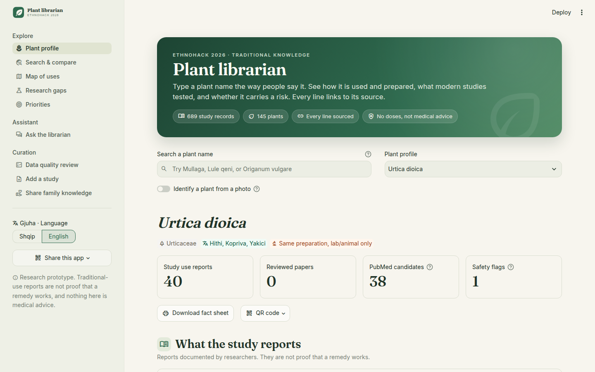
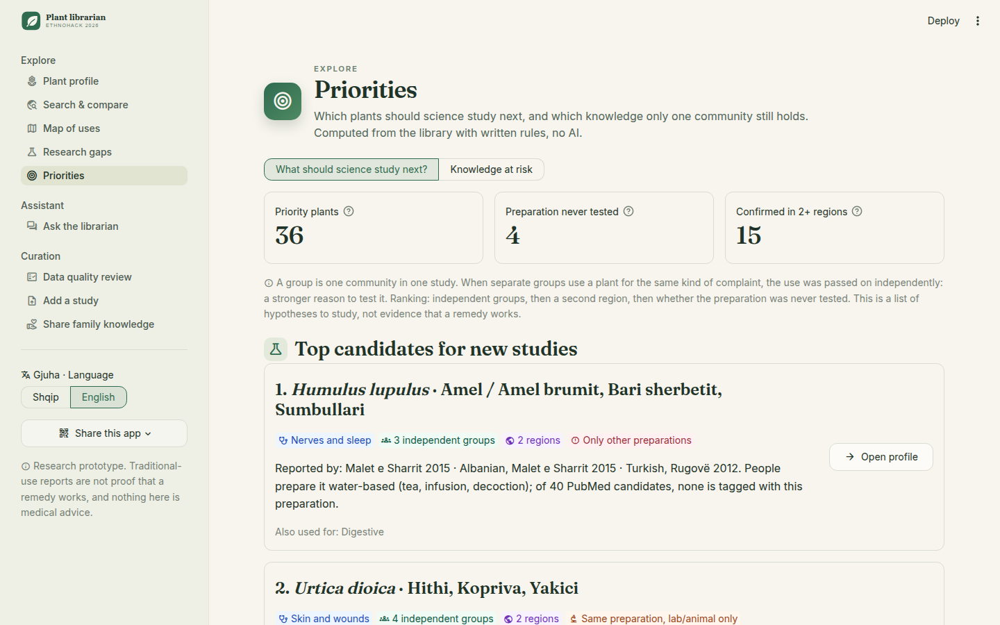
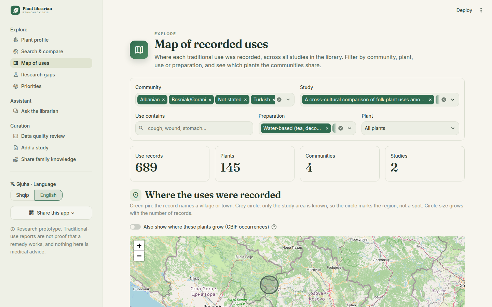
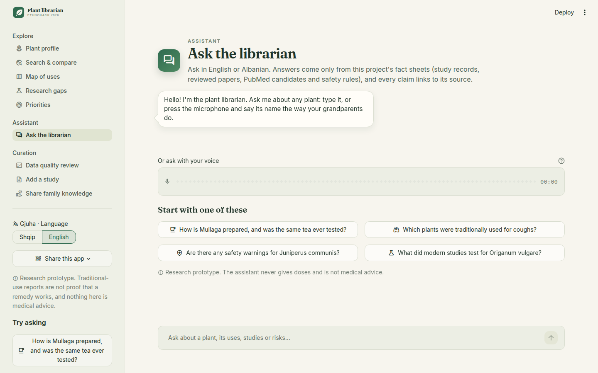
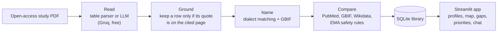

# Plant Librarian

**Traditional plant knowledge from Kosovo and Albania, read from the studies, checked against modern science,
and every line linked to its source.**

EthnoHack 2026 · Track 1: Traditional knowledge · Rizonë Hyseni, Dua Bilalli, Sara Kycyku, Rrezon Ibishi

[](https://plant-librarian.streamlit.app/?lang=en)
[](https://github.com/rizonehyseni/Plant-Librarian/actions/workflows/tests.yml)
[](docs/submission/slides.pdf)
[](LICENSE)

**Try it:** https://plant-librarian.streamlit.app/?lang=en (opens in English; the default is Albanian)



> Research prototype. Traditional use is not proof that a remedy works. The app never shows doses and is not
> medical advice.

## The problem

In the villages of the Sharr Mountains and the Albanian Alps, older people still know which plant to pick for
a cough, for sleep or for a wound. Researchers wrote this down in open-access studies, and scientists publish
thousands of papers on the same plants. Nobody connects the two:

- the knowledge is scattered across PDFs with different table formats;
- the same plant has a different name in every village: *Hithi*, *Kopriva* and *Yakici* are all nettle;
- modern studies usually test an essential oil or an alcohol extract, not the tea people actually drink.

Plant Librarian answers, in seconds and with a source for every line: **"Was the tea my grandmother drinks ever
tested?"**

## What we found

| | |
| --- | --- |
| **689** traditional-use records | from 2 open studies, each with page and exact quote |
| **145** plants | every name confirmed by GBIF |
| **3** communities | Albanian, Bosniak/Gorani and Turkish (Sharr Mountains) |
| **17** research gaps | studies exist, but none tests the preparation people use |
| **36** priority plants | same use in 2+ independent groups, preparation never tested in people |
| **73** plants, **119** uses | reported by one group only: knowledge at risk of being lost |
| **18** plants | used by all three Sharr communities |
| **21** plants | carry an EMA/HMPC safety flag |

**Number one priority: hop (*Humulus lupulus*, *Bari sherbetit*).** Albanian and Turkish families in Sharr and
people in Rugovë drink it as a tea for sleep and nerves. Of 40 PubMed papers, none tests the tea: they study
essential oils, alcohol extracts and isolated compounds.

All numbers are computed from the database by `make stats`, never typed by hand.

## What it does

| Page | What you can do |
| --- | --- |
| **Plant profile** | Type a plant's name the way people say it (dialect or Latin) or identify it from a photo. See uses per community with page and quote, *was the same preparation tested?*, PubMed candidates, safety flags and a map. Print a fact sheet or share a QR code. |
| **Search & compare** | Filter and compare records across plants, parts and preparations. |
| **Map of uses** | Where every use was recorded, with filters, and which plants the communities share. |
| **Research gaps** | Every plant's preparation verdict, gaps first, CSV export. |
| **Priorities** | *What should science study next?* and *Knowledge at risk*. |
| **Ask the librarian** | Chat in Albanian or English, by text or voice; answers only from our fact sheets, every claim cited, no doses. |
| **Data quality review** | Check, correct and verify records, with the automatic PDF check and an audit log. |
| **Add a study** | Upload a new open-access PDF; its plants appear on the map. |
| **Share family knowledge** | Add a use you learned at home: two consents, no names, doses refused, published only after review, withdrawable. |

The whole interface is in **Albanian and English** (toggle in the sidebar).

<table>
<tr>
<td width="50%"><br><b>Priorities:</b> what science should study next.</td>
<td width="50%"><br><b>Map of uses:</b> where each use was recorded.</td>
</tr>
<tr>
<td width="50%"><br><b>Ask the librarian:</b> text or voice, Albanian or English.</td>
<td width="50%"><br><b>Plant profile:</b> every line sourced.</td>
</tr>
</table>

## How it works



| Step | Module | What it does | AI? |
| --- | --- | --- | --- |
| Read | `pipeline/extract.py`, `extract_sharr_table.py` | Study → rows: plant, part, preparation, use, page, verbatim quote | LLM for free text; rules for tables |
| Ground | `pipeline/extract.py`, `autocheck.py` | Drops a row whose quote is not on the cited page; checks every record on each build | No |
| Name | `pipeline/names.py` | Dialect-tolerant matching (rapidfuzz, Albanian name list), confirmed with GBIF | No |
| Evidence | `pipeline/evidence.py`, `compare.py` | PubMed candidates, preparation and study-type tags, *was the same preparation tested?* | No |
| Safety | `pipeline/flags.py` | EMA/HMPC rules; amounts in study tables are replaced with `[amount]` | No |
| Priorities | `pipeline/priorities.py` | Independent groups per body system; knowledge only one group reports | No |
| Chat, voice | `pipeline/chat.py`, `voice.py` | Answers only from numbered fact-sheet lines; Whisper speech to text | LLM, grounded |
| Photo | `pipeline/photo.py` | Pl@ntNet suggestions, matched to the library | External model |

**AI is used only where text has to become a table, or speech has to become text.** Everything that must be
right (safety, evidence level, priorities) comes from written rules and open databases.

## Why you can trust it

- **Every record has a page and an exact quote**, shown in the app.
- **95% recall** (40 of 42) on hand-checked gold rows: table parser 23/23, LLM extraction 17/19 (`make eval`).
- **677 of 689 records pass the automatic PDF check**; the 12 that fail are table rows split across a page
  break, flagged for a person to fix.
- **A machine check is never a human verification.** Records stay *Needs review* until a named person verifies
  them on the Data quality review page.
- **Reproducible:** every API and LLM response is cached; `OFFLINE=1 make build` rebuilds the whole library
  without network. 65 tests and an offline build run in GitHub Actions on every pull request.
- **Only free services.** No part of the project needs a paid key.

## Ethics

- **No doses**, anywhere: amounts from study tables are removed, the chat refuses them, and the family form
  rejects them.
- **Consent first:** family knowledge needs the consent of the sharer and of the person who holds the
  knowledge; no names of people are collected; a reviewer approves each entry, and it can be withdrawn.
- **Honest labels:** PubMed tags are keyword screening, not a review; photo IDs are suggestions; *knowledge at
  risk* compares only the studies in the library.

## Data sources and licences

| Data | Source | Licence |
| --- | --- | --- |
| Traditional uses | Mustafa et al. 2015, Sharr Mountains ([J Ethnobiol Ethnomed](https://doi.org/10.1186/s13002-015-0023-5)); Mustafa et al. 2012, Albanian Alps ([J Ethnobiol Ethnomed](https://doi.org/10.1186/1746-4269-8-6)) | CC BY 4.0; CC BY 2.0 |
| Plant names, occurrences | [GBIF](https://www.gbif.org/) | CC BY 4.0 / per dataset |
| Modern evidence | [PubMed](https://pubmed.ncbi.nlm.nih.gov/) E-utilities | NLM terms of use |
| Compounds | [Wikidata](https://www.wikidata.org/) / LOTUS | CC0 |
| Safety | EMA/HMPC herbal monographs (URLs in `data/seed/risk_rules.csv`) | Public documents |
| Photo identification | [Pl@ntNet API](https://my.plantnet.org/) | Free for non-commercial use |
| LLM, speech to text | [Groq](https://console.groq.com/) free tier (`gpt-oss-120b`, Whisper) | Groq terms of use |
| Family knowledge | Entries shared in the app with two consents | CC BY 4.0, given by the contributor |

## Run it yourself

```bash
git clone https://github.com/rizonehyseni/Plant-Librarian.git && cd Plant-Librarian
python -m venv .venv && source .venv/bin/activate    # Windows: .venv\Scripts\activate
pip install -r requirements.txt
OFFLINE=1 make build     # builds data/ethnohack.db from the committed caches, no network or key needed
make app                 # http://localhost:8501
make test                # unit tests
make eval                # accuracy against eval/gold.csv
```

Chat, voice and *Add a study* need a free `GROQ_API_KEY` (https://console.groq.com/keys) in `.env`
(`cp .env.example .env`); photo identification needs a free `PLANTNET_API_KEY`. Everything else runs offline.
No `make` (Windows)? Run the commands from the [Makefile](Makefile), e.g. `python -m pipeline.build`.
To deploy your own copy for free on [Streamlit Community Cloud](https://share.streamlit.io): main file `app/app.py`,
Python 3.12, and `GROQ_API_KEY` (optionally `PLANTNET_API_KEY`, and `APP_URL` = your app's link for the QR codes) in
*Secrets*. The app builds its database from the committed caches on first start.

## Repository

```
app/            Streamlit app: app.py (navigation), pages/, i18n.py (Albanian/English), factsheet.py, ui.py
pipeline/       build steps: extract, names, evidence, compare, flags, priorities, chat, voice, photo, ...
data/raw/       the open-access study PDFs
data/seed/      hand-curated lists: sources, Albanian names, places, safety rules, reviewed evidence
data/cache/     cached API and LLM responses (offline rebuild)
eval/           gold rows, accuracy and stats scripts
tests/          unit tests
docs/           submission: slides (PDF) and Devpost text
```

## Limitations

- Two studies so far; *knowledge at risk* gets more reliable with every study added.
- PubMed preparation and study-type tags are keyword rules and can mislabel an abstract.
- The Albanian name list and the place gazetteer are small and hand-made.
- Conservation status (IUCN) is optional and missing for many Balkan plants.
- Photo identification and speech to text come from external models and can be wrong.

## Team

Rizonë Hyseni · Dua Bilalli · Sara Kycyku · Rrezon Ibishi

Code under the [MIT License](LICENSE). Study data keeps the licence of each source (see above).
